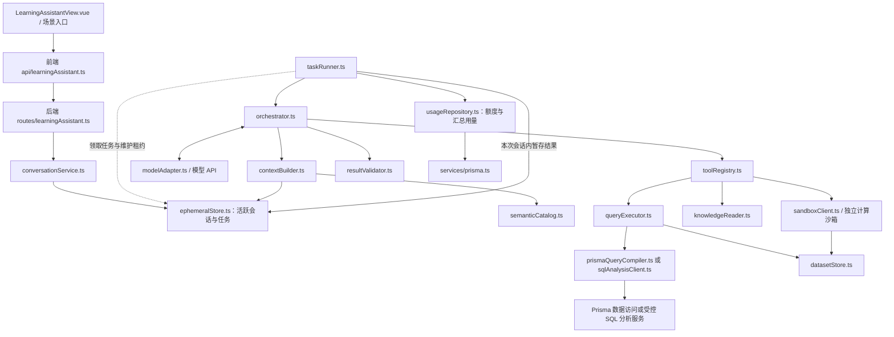
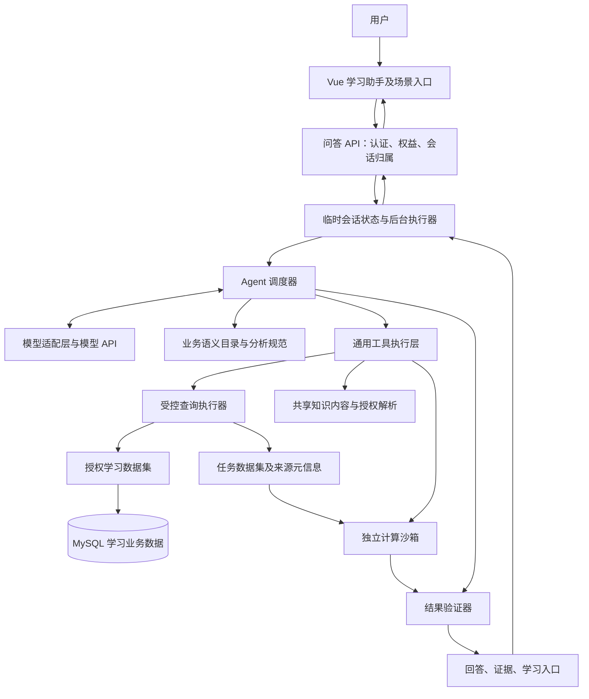
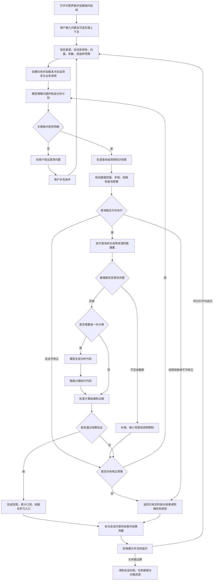
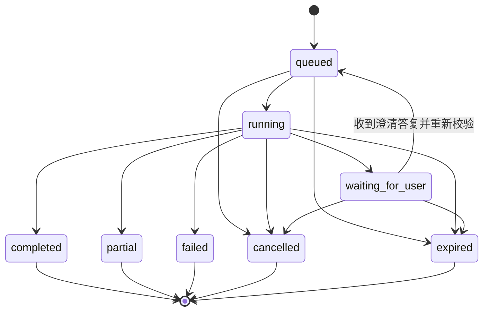

# 学习智能问答 Agent 实现方案

> 编制日期：2026-11-15  
> 更新日期：2026-11-16（调整为关闭即清除的临时多轮会话）  
> 适用项目：QuizTestDemo  
> 文档状态：设计稿，尚未开发。本文的接口、数据集、工具及新增模型均为拟议设计，示例数据不代表真实用户情况。  
> 方案定位：模型自主理解问题、制定分析计划、查询授权数据、生成并执行分析代码，最终给出有依据的学习回答。

## 1. 建设目标与最终方案

在用户侧增加学习智能问答入口，让用户围绕自己的作答记录、考试表现、错题、知识点和诊断报告自由提问。系统通过一个学习分析 Agent 完成多步查询与计算，并结合平台教学内容解释结果、提出学习建议。

最终实现主线为：

**用户提问 → 模型理解与规划 → 受控查询学习数据 → 模型动态生成分析代码 → 隔离环境执行 → 核验结果 → 回答与学习入口。**

模型负责决定需要哪些数据、怎样分析以及是否需要补查；后端负责身份、权限、数据访问和任务管理；计算环境执行模型生成的代码。系统提前建设通用能力，不为每一种提问或每一个衍生指标单独开发接口。

查询层优先验证**受控 Text-to-SQL**，以支持复杂关联、时间窗口和未预设的分析问题；同时保留**结构化查询计划转换为 Prisma 查询**的实现路径。两种查询方式共用业务语义、任务、数据结果和分析契约，仅在第 7 章集中比较。查询方式尚未完成实测选型，本文不把推荐意见表述为已经批准或上线的架构变更。

### 1.1 用户可以提出的问题

- “我上个月 TMUA 的正确率是多少？与前一个月相比变化多少？”
- “排除重复刷题以后，我最近一个月有没有进步？”
- “最近四周，哪些知识点答得更快，但正确率反而下降了？”
- “我主要是难题不会，还是简单题也不稳定？”
- “结合我的错题，解释一下二次函数这个知识点。”
- “根据最近的学习情况，给我安排三天复习，每天半小时。”
- “这份诊断报告为什么建议我优先复习概率？”

上述问题是验收和演示样例，不是系统仅支持的固定问法。

### 1.2 首期范围

首期提供文字多轮问答、个人学习数据查询、动态计算、知识内容检索、报告解释、来源展示和学习入口推荐。只读取用户有权访问的数据，回答和建议不自动修改成绩、答卷、错题本、会员权益或学习计划。

会话采用**每次打开新建、同次打开内多轮、关闭后不保留**的生命周期。没有历史会话列表，不跨次打开恢复提问、回答或摘要。首期将刷新页面、离开并重新进入问答页面、关闭后再次打开问答面板都视为新会话；单纯切换浏览器标签页不主动关闭会话，但超过服务端有效期后需重新开始。

首次交付使用单个 Agent，由统一调度器组织模型、查询工具与计算环境。采用可替换的模型适配层和成熟的隔离计算服务，默认以 Python 完成数据分析。具体模型和计算服务通过真实问题评测确定，不在本文写死某个模型版本。

知识讲解按考试类型、知识点编号和关键词检索。业务说明与分析规范作为版本化资源由后端加载。MCP 不作为首期前置依赖；工具通过后端注册与调用即可。未来需要被其他 AI 应用复用时，可在同一套业务能力外提供 MCP 接口。

## 2. Agent 代码层架构

代码按“前端交互 → API 与任务管理 → Agent 调度 → 工具执行 → 数据及计算适配”分层。下列目录与模块是拟议实现，名称与后文接口、工具和任务设计对应；模块划分不代表每个文件都需要部署为独立服务。

### 2.1 代码目录示意

```text
quiz-web/src/
├── views/learningAssistant/
│   └── LearningAssistantView.vue       # 会话、输入、任务进度和回答页面
├── components/learningAssistant/
│   ├── AssistantEntry.vue              # 知识点、错题和报告页的问答入口
│   ├── ChatMessage.vue                 # 消息与分析结果展示
│   └── EvidenceCard.vue                # 数据依据、来源与学习入口
└── api/
    └── learningAssistant.ts            # API 类型与统一 callApi 请求

api/src/
├── routes/
│   └── learningAssistant.ts            # 鉴权、参数校验、消息和任务接口
├── constants/
│   └── learningAssistant.ts            # 任务状态、错误码及运行限制
└── services/
    ├── prisma.ts                       # 现有共享 Prisma Client
    └── learning-assistant/
        ├── contracts.ts                # 计划、工具、数据集和结果的类型与校验
        ├── conversationService.ts      # 临时会话创建、归属、消息幂等与关闭清理
        ├── ephemeralStore.ts           # 活跃会话、消息、摘要和任务的短期存储
        ├── usageRepository.ts          # 不含聊天内容的额度与汇总用量持久化
        ├── taskRunner.ts               # 活跃任务领取、租约、取消与结算
        ├── orchestrator.ts             # 模型与工具的执行循环及预算控制
        ├── contextBuilder.ts           # 问题、本次会话消息、页面上下文与规则组装
        ├── semanticCatalog.ts          # 数据字典、指标口径、关系及版本
        ├── modelAdapter.ts             # 模型消息、工具调用和用量格式适配
        ├── toolRegistry.ts             # 工具定义、参数校验及执行函数分发
        ├── queryExecutor.ts            # 查询统一入口、权限与完整性检查
        ├── prismaQueryCompiler.ts      # 查询计划转为 Prisma 查询的实现
        ├── sqlAnalysisClient.ts        # 受控 SQL 分析服务的调用适配
        ├── knowledgeReader.ts          # 共享知识内容与授权题目解析读取
        ├── datasetStore.ts             # 任务数据集的归属、引用和生命周期
        ├── sandboxClient.ts            # 代码执行、状态查询、中止与结果回收
        └── resultValidator.ts          # 数值、数据完整性、来源和回答核验

外部运行边界
├── 模型 API                            # 接收上下文，返回计划、工具调用和回答
├── 独立计算沙箱                        # 执行模型生成的分析代码
└── 受控 SQL 分析服务                   # 采用 Text-to-SQL 并明确规则例外后启用
```

共享知识内容由 `knowledgeReader.ts` 通过统一内容契约读取，前后端使用同一份版本化内容源。原始 SQL 执行和模型生成的分析代码都不能直接放进路由处理函数中。

### 2.2 模块调用关系

图中实线表示调用或数据访问，虚线表示后台任务领取。HTTP 请求负责提交与查询任务状态，后台执行器负责持续推进 Agent，不在一次 HTTP 请求中等待全部分析完成。



`queryExecutor.ts` 在部署时选择一个查询适配器，两个适配器返回相同的数据集契约。适配器的差异收敛在查询层，`orchestrator.ts`、计算沙箱和前端无需分别实现两套流程。Text-to-SQL 的启用条件与对比见第 7 章。

### 2.3 核心模块如何协作

1. **接收问题**：每次打开由 `conversationService.ts` 创建新的临时会话；路由复用登录中间件，检查会话归属、有效期和幂等键，通过 `ephemeralStore.ts` 暂存消息及待执行任务。
2. **启动执行**：`taskRunner.ts` 领取任务并建立租约，将可信用户身份、任务 ID、截止时间和预算交给 `orchestrator.ts`。
3. **组装上下文**：`contextBuilder.ts` 只读取本次打开期间的相关消息、临时摘要和页面定位信息，再按需加入 `semanticCatalog.ts` 中的数据说明；所有业务标识均在服务端复核权限。
4. **驱动模型与工具**：`orchestrator.ts` 通过 `modelAdapter.ts` 请求下一步；模型返回工具调用时，交给 `toolRegistry.ts` 校验并分发。工具结果回传模型，继续查询、计算或生成回答。
5. **查询和计算**：`queryExecutor.ts` 取得授权数据并建立任务数据集；`sandboxClient.ts` 按数据集引用执行模型生成的代码。两者共享数据契约，但不向沙箱传递数据库凭据。
6. **核验与完成**：`resultValidator.ts` 检查结果和来源；需要修正时由调度器在预算内继续运行，结果只暂存于有效会话，用量通过 `usageRepository.ts` 结算。会话关闭或过期后取消在途任务，清除消息、摘要、数据集和沙箱资源，后到的回调不能重建已关闭会话。

`contracts.ts` 提供跨模块的数据契约，`constants/learningAssistant.ts` 提供集中状态与错误码。`orchestrator.ts` 只承担调度，不嵌入具体数据库查询和沙箱供应商协议；持久化、数据检索、模型通信与代码执行各有明确入口，便于独立测试和替换实现。

## 3. 总体架构



### 3.1 各层职责

| 模块 | 主要职责 |
| --- | --- |
| 前端 | 提问、展示会话和任务状态、显示依据、承接追问及学习导航 |
| 问答 API | 身份认证、输入校验、会话归属、额度预占、创建与取消任务 |
| Agent 调度器 | 组织模型调用、执行工具、控制轮次、处理补查和错误修正 |
| 模型适配层 | 统一消息、工具定义、工具结果、结构化输出、用量和错误格式 |
| 业务语义层 | 数据粒度、字段含义、指标口径、关系、单位、时间和版本规则 |
| 查询执行器 | 校验查询、强制用户范围、控制资源、返回完整性与来源信息 |
| 计算沙箱 | 在独立环境执行模型生成的分析代码，返回结果或结构化错误 |
| 结果验证器 | 校验数值、范围、来源和结论一致性；决定完成、补查或降级 |
| 任务与观测层 | 管理有效会话内的临时状态、重试和取消，持久化不含内容的汇总用量 |

数据库凭据、模型 API Key、登录凭据均不提供给模型生成的代码。模型不能自行切换用户身份、查询环境或查询执行模式。

## 4. 完整运行流程



### 4.1 上下文如何取得

每次运行由后端组装上下文，不依赖模型自动读取数据库或永久记住用户情况。

1. 前端提交用户问题，以及当前考试、知识点、题目或报告的标识。
2. 后端从已验证登录会话取得 `userId`，重新核验所有页面标识的访问权限。
3. 后端读取本次临时会话的必要消息和摘要，加载相关数据说明、指标定义与工具列表；不读取已经关闭的会话。
4. 模型提出查询或分析需求；后端执行后，将结果摘要、结构和数据集引用返回模型。
5. 大体量明细直接交给计算沙箱；模型只接收字段说明、必要样例、完整性信息与分析结果。

前端上下文是定位线索，不是数据库事实。用户在问题中陈述的成绩、题量和时间，也不能覆盖服务端查询结果。

### 4.2 规划与澄清

模型计划至少说明：分析目标、考试与学科范围、时间范围、数据集、记录粒度、统计口径、需要的操作和预期结果形式。计划是可检查的任务说明，不要求把模型的内部推理过程展示给用户。

“上个月”由服务端当前时间和 `Asia/Shanghai` 时区确定；请求中固定本次运行的参考时间，避免跨日、跨月重试改变含义。无法从问题、页面或会话确定的关键条件应询问用户。存在产品默认口径时可以直接采用，但回答必须说明。

用户只问概念、且无需个人数据时，直接读取相关知识内容回答。缺少数据、没有查询权限、查询失败和样本不足是不同结果，不能互相替代。

### 4.3 临时会话生命周期

每次打开问答界面，后端生成新的随机 `conversationId` 并绑定当前用户和当前页面实例。前端只在本次页面内存中保存 ID 与消息，不写入 localStorage、sessionStorage、IndexedDB 或可用于恢复会话的 URL。刷新、关闭后重开、退出再进入时都创建新 ID；不同标签页不共享会话。

同一次打开期间保留当前会话的消息、已明确的考试范围和用户主动提供的学习时间等上下文。关闭后清除消息、回答、临时摘要、分析代码、查询内容及运行数据，不建立跨会话偏好记忆。用户既有的答卷、错题、报告和知识内容属于原业务数据，下一次仍可按权限重新查询，不随聊天会话清理。

正常关闭通过后端关闭接口立即使会话失效，并取消任务、清除内容和回收资源；前端同步清空本次状态。为防止关闭与运行完成同时发生，所有写回都检查会话有效状态，迟到结果不得重新创建会话或续期。

浏览器强退、系统休眠或网络断开时，关闭请求不保证送达，因此用心跳与短期过期兜底。初始建议页面每 30 秒续期，服务端在最后一次有效页面心跳后 5 分钟使会话过期并清理；后台任务、轮询结果和模型回调不能替页面无限续期。这些时间可配置，异常关闭不承诺瞬间完成服务端清理。仅切换标签页不主动关闭，但后台节流或长时间断网可能导致会话过期，返回时明确提示重新开始。

路由退出、关闭面板和 `pagehide` 均尝试发起关闭通知；从浏览器往返缓存恢复时也创建新会话。统一请求层可为关闭通知提供携带既有认证信息的 `keepalive` 请求支持，页面仍只调用 API 模块。关闭事件和请求都只作为尽力通知，过期清理承担兜底。参见 [MDN 页面隐藏事件说明](https://developer.mozilla.org/en-US/docs/Web/API/Window/pagehide_event) 与 [keepalive 说明](https://developer.mozilla.org/en-US/docs/Web/API/Request/keepalive)。

### 4.4 多轮对话、轮数与上下文配置

“一次会话”指从本次打开到关闭或过期的生命周期；“一轮对话”指用户的一次有效提问及其对应的助手答复。首期建议每次会话最多 **20 轮**，这是可调产品参数，不是模型只能对话 20 轮。网络重试、工具调用和自动代码修正不新增对话轮数；提交前被校验拒绝的输入不计轮；进入分析流程后失败、取消或收到澄清答复的用户轮次仍计入，后续补充作为下一轮。

| 配置项 | 初始建议 | 作用 |
| --- | --- | --- |
| `maxConversationTurns` | 20 轮 | 限制本次打开内的用户提问数，由服务端原子计数 |
| `recentFullTurns` | 最近 6 轮 | 优先保留完整消息，较早内容整理为本次会话内的临时摘要 |
| `contextTokenBudget` | 根据选定模型和成本目标配置 | 约束每次请求总输入，预留工具结果与回答空间；轮数不能替代 Token 限制 |
| `maxToolCallsPerTurn` | 8 次 | 限制一个用户问题内部的工具调用，不等于允许用户提问 8 次 |
| `maxRepairAttemptsPerTurn` | 2 次 | 限制查询或代码自动修正 |
| `heartbeatIntervalSeconds` | 30 秒 | 当前页面实例续期 |
| `sessionLeaseSeconds` | 300 秒 | 关闭通知丢失时的临时内容清理边界 |

上述数值是开发与压测起点。实际请求根据 Token 预算选择近期消息，不保证每次都能完整容纳 6 轮；摘要也有长度限制，不能把已压缩的内容当作完整原文。复杂分析需要更多空间时，优先传递数据集结构与引用，避免把全部明细塞入消息。

`contextBuilder.ts` 在每次提问时重新组装模型输入：系统规则、业务说明、本次会话的临时摘要、近期完整消息、当前问题，以及按需取得的授权数据或工具结果。多轮理解依靠后端传入这些上下文，不能只传新的问题并假定模型会自行记住上一次 API 调用。

达到 20 轮后，允许查看本次仍有效的内容，但暂停新增提问并提供“开始新会话”。用户主动开始后销毁旧会话并创建新会话，不自动在追问中途清空上下文。页面保持打开且租约有效时可连续追问；页面短暂断网但实例未重建、会话未过期时可以继续当前任务查询，刷新或重新打开则不能恢复。

追问“去掉重复做过的题呢”时，继承本次会话上轮的考试和时间范围，修改去重规则后重新分析。追问“现在呢”或产生新答卷后重新查询最新数据。临时摘要保留必要的业务范围和结论来源，不把模型推测写成用户事实；所有摘要随本次会话一起清除。

## 5. 业务语义层与数据集

业务解释通过版本化的数据目录、字段定义、指标口径和分析规范实现。开发人员依据现有代码与报表梳理，产品确认有歧义的定义，再由后端按需提供给模型。

### 5.1 授权逻辑数据集

逻辑数据集是统一的查询契约，可以由 Prisma 或 SQL 执行器实现；不表示当前已经创建同名数据库表。

| 逻辑数据集 | 来源 | 粒度与用途 |
| --- | --- | --- |
| `answer_attempts` | `ExamRecord`、`AnswerRecord`，关联题目分类 | 一份已提交答卷中的一道题；用于准确率、用时、重复练习等分析 |
| `exam_results` | `ExamRecord` 及既有评分服务 | 一份已提交答卷；用于考试趋势和整卷表现 |
| `attempt_knowledge_links` | 作答题目与 `QuestionKnowledgePoint`、`SyllabusNode` 的关联 | 一次作答与一个知识点的关系；不能直接求和为总作答数 |
| `wrong_question_events` | `WrongQuestionAttempt` 及授权题目资料 | 一次错误事件；区分历史错误与当前错题本状态 |
| `diagnostic_reports` | `DiagnosticReport` | 一份带生成时间和版本的报告快照 |
| `learning_activities` | 既有学习足迹服务及相关活动记录 | 学习活动，不能直接作为答题正确率或掌握程度 |
| `knowledge_content` | 共享知识内容源 | 某考试、某知识点、某版本的概念与方法 |

当前 `Question` 是正式题目数据源，不读取 `Paper.questions` 计算新业务结果。题目正文与解析使用现有 `content/solution/meta` 契约，不能在新增分析表中维护另一份可独立修改的官方题库。

历史答卷的选科、题目范围、题序和版本边界遵循既有答卷快照及历史迁移规则，不能用当前年度全科题量替代用户当时选科的题量。关联发生版本迁移时，应保留有效的来源与映射信息；无法可靠还原的记录需要标记，不能强行比较。

### 5.2 字段说明

| 字段或概念 | 解释要求 |
| --- | --- |
| 作答记录 ID | 对应一份答卷中的一道题；修改答案不等于新增一次完整练习 |
| `questionId` | 题目身份；不同答卷出现相同 ID 表示重复练习，题目修订关系另行识别 |
| 是否作答 | 结合现有作答状态和答案字段归一化；旧记录的兼容逻辑由后端完成 |
| `isCorrect` | 是否正确；`false` 本身不能区分错误与未作答 |
| 逐题用时 | 单位为秒，继承现有计时语义；无效或缺失用时单独标记，不能默认为有效零秒 |
| 作答时间与交卷时间 | 两者语义不同；默认期间统计使用哪一个必须写入计划和结果 |
| 知识点关系 | 一题可关联多个知识点；知识点分组的样本数可能重叠 |
| 难度与学科 | 使用项目集中定义和有效分类，不让模型自行创造枚举值 |
| 未映射题目 | 保留“未映射”状态及数量，不能为了图表完整而猜测知识点 |
| 数据更新时间 | 记录查询时点、覆盖区间、版本和完整性，防止将历史报告当作实时统计 |

### 5.3 指标与分析口径

指标说明分为平台既有标准和用户本次要求的分析定义。既有正式分数、换算曲线和报告指标复用当前服务；Agent 不自行重算或更改正式成绩规则。

新增问答展示建议明确区分：

- **已作答正确率**：正确作答次数 / 已作答次数。
- **整卷正确比例**：正确题量 / 本次实际答卷题量；未作答仍在分母内。
- **独立题量**：按照明确的题目身份去重后的数量。
- **首次作答表现**：对指定范围内的题目，按约定选择首次有效作答；必须区分“范围内首次”与“历史首次”。
- **重复练习表现**：保留同题不同答卷的作答，并明确时间与排序规则。
- **百分点变化**：两个百分比相减；相对增幅另行计算，原值为零时不能直接相除。

以上命名和默认口径须在实现时与现有页面核对并形成正式版本，不能静默替换既有产品定义。复杂分析公式可以由模型动态生成，但本次采用的定义必须可追溯。

无作答记录时，正确率为“暂无数据”，不能返回 0%。汇总正确率按总正确数与总分母计算，不直接平均题量不同的答卷正确率。

### 5.4 查询结果契约

查询工具返回数据集引用、必要摘要和元信息；该契约由两种查询执行器共同遵循。

```json
{
  "datasetId": "运行内的数据集标识",
  "schemaVersion": "learning-data-v1",
  "semanticVersion": "learning-semantics-v1",
  "grain": "一份已提交答卷中的一道题",
  "timezone": "Asia/Shanghai",
  "timeBasis": "submittedAt",
  "dataAsOf": "2026-11-15T10:00:00+08:00",
  "range": {
    "start": "2026-10-01T00:00:00+08:00",
    "endExclusive": "2026-11-01T00:00:00+08:00"
  },
  "rowCount": 100,
  "matchedRowCount": 100,
  "complete": true,
  "truncated": false,
  "invalidDurationCount": 0,
  "unmappedKnowledgeCount": 0,
  "sourceRefs": ["服务端生成的授权来源引用"]
}
```

示例中数量和日期仅说明结构。`dataAsOf` 是查询或快照的参考时点；如果多次查询没有共享一致快照，需要额外标注一致性边界，不能声称所有数据来自同一个数据库快照。无法准确取得总匹配量时，`matchedRowCount` 应为空并说明原因，不编造总量。

数据集 ID 由服务端生成并绑定用户、任务、权限和失效时间。不能因为获得了 ID 就绕过归属检查。

## 6. Agent 调度与通用能力

### 6.1 工具契约

| 工具 | 输入重点 | 输出与职责 |
| --- | --- | --- |
| `describeLearningData` | 相关业务域或数据集名称 | 返回字段、关系、指标说明及允许的操作；不暴露数据库凭据 |
| `queryLearningData` | 结构化分析计划及当前配置要求的查询表示 | 执行授权查询，返回统一数据集契约 |
| `runAnalysis` | 当前任务数据集 ID、代码、预期输出结构 | 执行计算，返回结构化结果、警告和执行状态 |
| `searchKnowledge` | 考试、知识点或检索词 | 返回有版本、来源和权限信息的教学片段 |
| `getQuestionExplanation` | 授权题目或作答标识 | 复用已有题目与解析链路，提供允许查看的内容 |

工具包含模型可读的名称、说明和 JSON Schema，以及后端注册的执行函数。用户身份通过可信执行上下文注入，不设计为模型可任意填写的工具参数。

业务规范可以整理成 Skill 格式，但必须由应用实现发现和加载；普通模型 API 不会自动读取仓库中的 `SKILL.md`。首期按版本化资源加载必要规范即可。

### 6.2 调度循环

1. 调用模型，接收最终回答、工具调用或澄清请求。
2. 校验工具名称、参数结构、数据范围和剩余预算。
3. 执行工具，将工具调用 ID 与对应结果完整回传模型。
4. 模型根据结果继续分析、补查或修正代码。
5. 达到完成条件后进入结果验证；达到预算上限时返回已核实的部分结果或明确限制。

修正次数、工具轮次、输入输出 Token、总运行时长、数据库与沙箱资源分别限额。初始配置可以将每个用户问题内部的工具调用上限设为 8 次、自动修正上限设为 2 次、任务总时长上限设为 120 秒，作为待压测的起点，不作为对用户的性能承诺。这些是单次分析预算，与第 4.4 节每会话最多 20 轮用户问答分别计数。

鉴权失败、跨用户访问、禁止字段和考试解析限制属于不可自动绕过的错误。语法错误、允许范围内的参数错误和沙箱运行错误可以在预算内修正。不能通过切换查询模式或换工具绕过拒绝结果。

### 6.3 模型与知识内容接入

问答独立配置模型、提示词版本、上下文预算、超时和用量上限，避免更改诊断报告参数时影响问答。工具消息格式、结构化输出、流式能力和用量字段由提供商适配器处理，不能假设所有接口完全一致。

前端知识讲解需要整理为共享、无 UI 依赖的内容源，按考试类型、精确知识点编号和版本读取。共享内容应保持单一编辑来源，前端页面与后端引用使用同一版本。图形若需要解释，应提供可读的文字或结构语义，不能只把 Vue 组件名称交给模型。

知识检索是模型引用教学内容的入口；正确率和用时仍来自业务数据。检索片段作为资料处理，不能把其中的文字当作权限或工具执行指令。

## 7. 查询层实现与两种方案对比

### 7.1 共同边界

两种方式共享同一组授权逻辑数据集、业务口径、结果契约和评测集。查询模式由服务端部署配置决定，模型不能自行选择访问生产库或切换执行器。

两种方案都需要以下工作：

- 数据集及关联关系说明、业务指标定义、相对日期解析。
- 当前用户和内容权益校验、来源可追溯、数据完整性标记。
- 超时、结果量与并发控制、错误反馈和有限修正。
- 数据范围与结果正确性评测。

模型“理解问题、制定分析计划”是查询生成的上层环节。模型直接输出 SQL 属于 Text-to-SQL；模型输出 JSON 查询计划，再由程序组装 Prisma 参数，属于自然语言到结构化查询。

### 7.2 方案 A：受控 Text-to-SQL

#### 实现步骤

1. 后端根据本次问题提供相关逻辑数据集、字段说明、关联规则、MySQL 方言及业务指标定义。
2. 模型输出 SQL、绑定参数和可展示的查询口径说明。
3. 查询执行器解析 SQL 语法树，验证数据源、字段、函数、操作和复杂度。
4. 服务端对每个获准的数据源落实当前用户与权限约束；模型生成的用户条件不承担授权职责。
5. 通过专用的只读执行入口运行查询，控制时长和资源，返回统一数据集契约。
6. 可以直接由 SQL 完成的聚合在数据库执行，后续复杂统计和可视化由分析沙箱完成。

例如，模型可以针对授权后的 `answer_attempts` 生成查询：

```sql
SELECT
  COUNT(*) AS answered_count,
  COALESCE(SUM(CASE WHEN is_correct THEN 1 ELSE 0 END), 0) AS correct_count
FROM answer_attempts
WHERE exam_type = :examType
  AND has_answer = 1
  AND submitted_at >= :startUtc
  AND submitted_at < :endUtc;
```

这是逻辑数据集上的示意 SQL，不能原样对现有业务库执行。命名占位符由执行器转换为数据库驱动的绑定参数；时间值由服务端按业务时区转换。逻辑数据集必须先建立用户范围、字段投影和状态规则，示例未在 SQL 文本中让模型填写 `userId`。

#### 执行边界

只允许批准的数据集及其关联，采用完整语法树检查，不能仅用字符串前缀或正则判断是否为 `SELECT`。首期限制为单条只读查询，禁止写操作、文件导出、系统信息读取和未批准的函数；CTE、子查询、UNION 等结构仅在授权遍历和测试覆盖完整后开放。

在当前 MySQL 架构下，不能假定天然具有按应用用户隔离的行级权限。执行器必须将每个基础数据源解析为可信的、带用户范围的关系，并让服务端绑定身份参数；无法证明所有数据源均受约束的查询直接拒绝。只在最外层追加一个 `WHERE userId = ...` 不能保证子查询和 UNION 的隔离。

分析账号只读并采用最小权限。运行在只读副本或独立分析数据源时，返回同步时间和数据延迟；仅配置只读账号也不能代替用户隔离。`LIMIT` 只约束返回量，不能代替执行超时和查询成本控制。

#### 与仓库规则的关系

当前 `AGENTS.md` 要求“所有数据库访问必须通过 Prisma Client；不要使用原始 SQL”。本方案会涉及原始 SQL 执行，必须在实际实现前明确调整规则，限定到受控分析服务及批准的数据集；其他业务接口继续沿用现有规则。使用 `prisma.$queryRaw` 仍然是原始 SQL，不能视为自动符合现行约束。

本文件仅记录推荐方向和实施前提，不修改 `AGENTS.md`，不授权任意 SQL 访问，也不代表已经选定分析数据库、连接账号或部署方式。

### 7.3 方案 B：结构化查询计划转换为 Prisma

#### 实现步骤

1. 定义查询计划的 JSON Schema，包含数据集、字段、筛选、排序、分组和基础聚合。
2. 建立字段注册表，保存业务字段对应的 Prisma 位置、数据类型和允许的运算符。
3. 模型输出查询计划，Zod 校验结构及参数。
4. 通用解释器将字段、运算符和关联路径转换为 `where/select/orderBy/groupBy` 等参数。
5. 服务端在最外层固定加入用户范围和业务状态条件，使用共享 Prisma Client 执行。
6. 不能在现有解释器中表达的分析，读取授权明细后交给计算沙箱；无法安全完成时明确返回不支持。

模型计划示例：

```json
{
  "dataset": "answer_attempts",
  "fields": ["questionId", "submittedAt", "hasAnswer", "isCorrect", "durationSeconds"],
  "filters": [
    { "field": "examType", "operator": "eq", "value": "TMUA" },
    { "field": "submittedAt", "operator": "gte", "value": "2026-10-01T00:00:00+08:00" },
    { "field": "submittedAt", "operator": "lt", "value": "2026-11-01T00:00:00+08:00" }
  ],
  "orderBy": [{ "field": "submittedAt", "direction": "asc" }]
}
```

字段注册表示例：

| 业务字段 | Prisma 数据位置 | 类型 | 支持操作 |
| --- | --- | --- | --- |
| `examType` | `AnswerRecord.examRecord.examType` | 集中定义的考试枚举 | 等于、属于集合 |
| `submittedAt` | `AnswerRecord.examRecord.submittedAt` | 日期 | 范围、排序 |
| `questionId` | `AnswerRecord.questionId` | 字符串 | 等于、属于集合 |
| `isCorrect` | `AnswerRecord.isCorrect` | 布尔值 | 等于、计数 |
| `durationSeconds` | `AnswerRecord.durationSeconds` | 数值 | 范围、排序、基础聚合 |
| `hasAnswer` | 既有作答状态及答案字段的归一化结果 | 布尔值 | 由已测试映射规则解释 |

转换层提前实现的是操作与关系，不是全部用户问题。它不执行模型生成的任意 JavaScript，也不接收任意 Prisma 对象后直接透传执行。

Prisma 对跨关联分组等查询存在表达边界，不能把任意 SQL 一一转换成一次 `groupBy`。转换器需要按支持范围拆分查询或返回授权数据集。稳定分页采用明确排序和游标，所有页应保持一致的数据范围；未取全时不能标记为完整。

### 7.4 对比

| 维度 | 受控 Text-to-SQL | 查询计划转换为 Prisma |
| --- | --- | --- |
| 查询表达能力 | 在批准 SQL 子集内支持复杂关联、子查询、CTE 和窗口分析 | 取决于解释器支持的字段、操作与关联 |
| 泛化能力 | 可以生成未预设的查询组合，适合开放式分析 | 可以组合已有操作；超出解释器边界需扩展或转交沙箱 |
| 计算泛化能力 | 可以与动态 Python 分析组合 | 同样可以与动态 Python 分析组合 |
| 原型成本 | 可省去自定义查询语言转换器，通常较快 | 需要先定义查询语言、注册表与解释器 |
| 正式上线成本 | 集中在 SQL 解析、授权约束、资源控制和语义验证 | 集中在转换器正确性、数据覆盖和扩展维护 |
| 查询结构正确性 | 可能出现字段、方言、关联和重复计数错误 | 已测试映射可减少结构错误，但解释器本身也可能有缺陷 |
| 业务准确性 | 依赖业务说明、数据质量及结果验证 | 同样依赖这些条件；Prisma 不自动保证口径正确 |
| 用户隔离 | 必须覆盖所有 SQL 数据源和嵌套结构 | 可以在固定执行入口强制合并用户范围 |
| 大规模计算 | 复杂聚合可下推数据库，但须控制查询成本 | 部分复杂操作需要取数后计算，增加传输与沙箱开销 |
| 新增业务数据 | 更新数据目录、授权规则和评测 | 还需更新字段映射及必要的转换逻辑 |
| 当前仓库适配 | 需要明确原始 SQL 的限定例外 | 符合当前 Prisma 数据访问规则 |

不能用“SQL 能运行”或“Prisma 类型检查通过”代替业务准确性，也不能仅因拒绝复杂问题较多就认定某方案更准确。比较时必须分别报告问题覆盖率和已回答问题的正确率。

### 7.5 选型与落地决策

基于开放式分析目标，优先验证受控 Text-to-SQL；前提是受控执行边界可落地、相关规则调整明确且验收通过。如果保持当前仓库约束，则使用 Prisma 路径完成同一 Agent 架构，复杂计算继续交给沙箱，不退回到逐个固定问答接口。

验证时使用相同的模型、业务说明、授权数据和测试问题，比较覆盖率、计划正确性、结果正确性、跨用户隔离、耗时和成本。查询提供者在部署配置中明确选择，不能在运行时因权限失败或查询不支持而静默切换另一条路径。

## 8. 动态分析与计算环境

### 8.1 模型生成代码

模型根据问题及数据契约生成分析代码，例如首次与最近一次作答比较、按难度分组、时间窗口分析、用时分位数、去重和趋势计算。无需提前为每一种衍生分析写业务函数。

代码只操作当前任务授权的数据集。平台正式评分仍调用既有业务能力；模型生成的新指标须说明定义，不冒充平台标准成绩或全国排名。

### 8.2 沙箱执行

使用成熟的隔离计算环境，默认预装 Python 和需要的数据分析库。沙箱与 Express 主进程隔离，不通过 `eval`、普通动态函数或仅有语言级隔离的执行方式运行不可信代码。

- 每个任务绑定独立的数据权限和执行空间，不能跨用户复用残留数据。
- 不提供数据库、模型和其他业务服务凭据，默认关闭无关网络访问。
- 限制 CPU、内存、执行时长、输出大小和可用依赖。
- 数据输入采用授权数据集引用，较大数据不全部进入模型消息。
- 执行结果返回表格、数值、警告和结构化错误；不直接将完整日志交给用户。
- 任务结束、取消或超时后回收执行资源，仅将追问需要的结果暂存于当前有效会话；会话关闭或过期时清理数据集、代码、结果及外部沙箱资源，不建立历史分析档案。

托管环境可以减少隔离与资源管理的自建工作，但仍需验证服务可用性、数据处理条件和运行限制。代码执行能力可参考 [Claude 官方说明](https://platform.claude.com/docs/en/agents-and-tools/tool-use/code-execution-tool) 与 [E2B 官方文档](https://docs.e2b.dev/)。具体提供商不在本文件中假定已经接入。

### 8.3 返回与核验

计算结果使用结构化格式，至少包含指标值、样本量、统计口径、时间范围、警告及来源引用。模型输出的自然语言必须与这些结果一致。

例如两个时期正确率分别为 80% 和 70%，应表述为提高 10 个百分点；如额外展示相对增幅，应单独标明约 14.3%。分母为零、数据缺失或覆盖不足时，返回对应状态而不是伪造数值。

分析计划、查询内容、代码、数据集指纹和结果仅在当前有效会话内暂存，用于结果核验与追问，关闭或过期后清除。长期观测只保存不含对话内容的用量、耗时、状态与标准错误码，不支持关闭后的对话重放。外部模型与沙箱的数据处理、日志和删除设置也需核对，应用侧清理不能被表述为提供商自动零留存。

## 9. 前端交互、接口与任务状态

### 9.1 用户入口

新增独立学习助手页面，展示本次会话的输入区、回答区和“开始新会话”操作，不提供历史会话列表。打开时提示“关闭后不保留本次对话”。知识点、错题解析和诊断报告页面增加场景入口，进入时显示正在讨论的知识点、题目或报告。

前端发送问题与业务标识，不提交数据库查询语句、用户身份或模型 API Key。正式考试进行中，服务端限制针对当前试题的解题分析和解析读取；不能仅靠隐藏前端入口实现限制。

回答包括正文、统计口径、数据日期、来源卡片和允许访问的学习入口。来源与导航由服务端核验后生成，不接受模型随意编造的内部链接。题目与公式沿用现有渲染链，Markdown 做安全渲染。

等待时展示“正在读取学习记录”“正在分析数据”等业务状态。取消仅停止当前问题的任务，保留本次会话中已产生的消息；关闭则结束整个会话并清除内容。刷新页面创建新会话，不恢复旧任务或消息。无需向普通用户展示 SQL、Python 代码、数据库表名或模型内部过程。

### 9.2 API 契约

以下为拟新增接口，普通响应继续使用 `{ success, code, errMsg, data }`，成功 `code: 0`，失败使用集中定义的业务错误码。

| 方法与路径 | 用途 |
| --- | --- |
| `POST /api/learning-assistant/conversations` | 为本次打开创建临时会话，返回 ID、轮数上限和有效期 |
| `POST /api/learning-assistant/conversations/:id/heartbeat` | 校验当前用户和页面实例，为有效会话续期 |
| `DELETE /api/learning-assistant/conversations/:id` | 幂等关闭当前会话，取消任务并清理内容 |
| `GET /api/learning-assistant/conversations/:id/messages` | 在本次页面实例内同步仍有效的消息及结果，不提供历史恢复 |
| `POST /api/learning-assistant/conversations/:id/messages` | 提交问题或澄清答复，返回消息 ID 和任务 ID |
| `GET /api/learning-assistant/runs/:id` | 获取任务状态、必要进度与最终结果 |
| `POST /api/learning-assistant/runs/:id/cancel` | 请求取消当前用户任务 |

首期使用异步任务与轮询：提交接口快速返回，后台继续运行，避免将多步 Agent 执行绑在当前前后端约 15 秒的普通请求超时上。前端所有请求通过 `quiz-web/src/api/` 模块和统一 `callApi` 发起；轮询在完成、失败、取消或组件卸载后停止。

所有消息、任务和数据集访问同时检查用户归属与临时会话有效性。已关闭或过期的会话返回集中定义的失效错误，旧 ID 和迟到的心跳不能重新激活会话。前端收到后清空本次状态，提示开始新会话。

消息请求携带客户端幂等键，服务端按“会话 + 幂等键”去重，并原子检查、递增用户轮数。网络重试不得重复创建任务、增加轮数或重复消耗用户额度。同一会话的运行按明确顺序处理，避免两个问题同时覆盖上下文。达到轮数上限时返回明确错误及当前轮数，不自动新建会话。

### 9.3 任务状态



`running` 在临时存储中记录规划、查询、计算、验证等阶段。`waiting_for_user` 释放执行资源，仅在会话仍有效时接收补充；补充消息计入下一用户轮次，并重新验证身份与权限。取消状态必须向查询和沙箱传递中止信号，不能仅停止前端轮询。关闭或过期则使整个会话失效，取消未完成任务并清理所有任务结果，包括已完成的结果。

首期单进程内存存储随服务重启丢失，前端明确提示本次会话已失效，不能从持久化日志重建。外部沙箱配置独立的执行时限与资源过期回收，防止服务异常退出遗留计算。同一次打开且会话仍有效时，短暂断网可继续查询原任务；不能确认执行状态时先检查执行句柄或标记中断，避免盲目重复付费执行。

## 10. 临时会话存储与成本管理

### 10.1 临时状态与留存边界

以下为运行时结构，不是拟长期保存聊天内容的数据库表。

| 临时结构 | 建议字段与职责 |
| --- | --- |
| `ConversationState` | 用户、页面实例、会话 ID、考试上下文、临时摘要、已用轮数、状态与有效期 |
| `MessageState` | 会话、角色、内容、结构化引用、来源上下文、幂等键、状态 |
| `RunState` | 用户、会话、触发消息、状态、阶段、分析计划、模型与语义版本、工具调用记录、用量、错误、执行句柄与时限 |

`ephemeralStore.ts` 管理这些结构及到期清理。单进程原型可使用有容量上限的内存存储；多进程部署必须采用共享的临时存储或明确的会话路由，不能假定不同进程共享内存。临时内容不进入持久化快照、备份或历史聊天表，所有派生缓存沿用会话的过期和关闭规则。

任务数据集的元信息包括所属用户和任务、字段与粒度、数据时点、指纹、完整性、失效时间和沙箱引用。数据集与临时文件绑定当前会话，关闭或到期后删除，不能以长期任务归档的形式变相保留聊天内容。

额度与成本可以通过 `usageRepository.ts` 长期保存最小必要的非内容用量记录，包括用户、时段、模型、Token、金额、状态及幂等结算标识；不得包含问题、回答、摘要、查询或分析代码。若因此新增 Prisma 模型，仍需正式迁移、迁移状态检查并更新数据库文档；Json 字段写入结构化值。本文不创建迁移文件或修改现有 schema。

### 10.2 用量与预算

记录模型输入输出 Token、工具次数、数据库耗时、沙箱运行时间和失败原因。模型重试和代码修正的实际成本也计入运行观测。

用户额度使用原子预占与结算，明确取消、失败和部分完成时的产品计费口径；不能根据 HTTP 重试重复扣减。管理员身份、会员状态和考试权益继续使用现有体系，不复用或混淆 `role` 的含义。

限制单用户并发、全局并发和单次预算，超过限制时返回明确状态。个人分析缓存仅在同一个有效会话中，且用户、权限、数据版本和查询口径均一致时复用，不跨会话保留。

生产日志、APM 和追踪系统只保留必要状态、标准错误码与非内容指标；关闭请求体、模型消息、查询参数、生成代码和沙箱输出的自动记录，避免错误堆栈带出这些内容，也不打印凭据。会话关闭、账户删除和运行数据到期需覆盖相关数据集及缓存，不遗留仍可访问的引用。

## 11. 准确性与验收

### 11.1 分层验证

| 层次 | 主要验证内容 |
| --- | --- |
| 问题理解 | 考试、时间、比较对象、去重方式和关键歧义是否被正确处理 |
| 查询计划 | 数据集、字段、关联、时间边界、用户范围和口径是否正确 |
| 数据结果 | 是否完整、是否重复、是否混入未提交或不属于用户的数据 |
| 计算 | 分子分母、权重、排序、单位、零值、空值和统计方法是否正确 |
| 解释 | 回答数字是否与结果一致，是否将相关性说成因果，是否忽略样本量 |
| 来源 | 引用是否实际存在、属于本次数据、仍可访问并正确跳转 |

结构化输出约束格式，不能证明业务含义正确；模型自检或第二次模型审查作为辅助，不能替代程序检查和独立标准数据。关于结构化输出的能力边界，参见 [官方接口说明](https://platform.claude.com/docs/en/build-with-claude/structured-outputs)。

### 11.2 评测集

先整理 20～30 个真实问题验证主链路，再扩展为覆盖不同语义和边界的固定评测集。评测数据使用受控测试数据或适当处理后的样本，不能直接复制真实用户完整数据进入公开测试资源。

至少覆盖：

1. 指定考试和月份的正确率、作答数与平均用时。
2. “上个月”与“最近 30 天”的不同时间边界。
3. 两份题量不同的答卷合并统计。
4. 未作答、无记录、无效用时与历史兼容记录。
5. 同题重复练习、范围内首次和历史首次。
6. 一题关联多个知识点，避免重复计数。
7. 同一知识点前后时期表现变化及难度分布变化。
8. 最新统计与旧诊断报告的时间差异。
9. 数据截断、部分读取、分页期间新增记录。
10. 查询报错、代码报错、超时、取消、重试和服务重启。
11. 跨用户数据集、会话、报告和题目引用访问。
12. 没有全国样本却要求全国排名、样本不足却要求确定结论。
13. 同次打开内多轮追问继承范围，摘要压缩后关键条件与来源仍准确。
14. 关闭重开、刷新、路由重入和浏览器往返缓存恢复均创建新会话，不同标签页互不串话。
15. 计算中关闭、关闭与结果同时到达、关闭通知丢失后的过期清理，迟到回调不能恢复内容。
16. 轮数上限、幂等重试不重复计轮、澄清答复计轮，以及主动开始新会话后的计数重置。

测试对比查询结果与业务结论，不只比较 SQL 字符串。分别报告覆盖率、已回答问题正确率、重复运行稳定性、延迟和成本。任何准确率数字必须注明数据集、题目范围和评测方法，不能承诺开放式问题始终 100% 正确。

### 11.3 上线门槛

- 固定基础数值样例全部与标准答案一致，边界样例不被转换成虚构数值。
- 用户归属、内容权限、进行中考试限制等强制测试全部通过。
- 问题超出能力或数据不足时能够澄清、说明限制或返回部分结果。
- 所有最终关键数字能够追溯到数据结果或计算输出。
- 任务取消、恢复和幂等请求不会造成重复运行失控或重复扣额。
- 关闭或过期后旧会话不可访问，聊天内容、派生缓存和沙箱资源按生命周期清理，日志及备份不保留聊天内容。
- 两种查询路径的实际覆盖率与成本有可比较记录，并完成查询提供者选型。
- 对模型、提示词、语义版本或查询规则的后续修改，运行同一组回归评测。

这些是发布门槛，不代表测试通过后开放式分析不再存在误差。上线后根据非内容错误统计和用户主动提交的反馈构造评测样例，不通过保留已关闭会话建立真实对话档案。

## 12. 代码与服务落点

以下路径为拟新增或拟调整位置，具体拆分以开发时的模块规模为准。

| 位置 | 计划职责 |
| --- | --- |
| `api/src/routes/learningAssistant.ts` | 临时会话创建、心跳、关闭、消息、运行状态及取消接口 |
| `api/src/services/learning-assistant/ephemeralStore.ts` | 活跃会话、轮数、消息、摘要与任务状态，过期和关闭清理 |
| `api/src/services/learning-assistant/usageRepository.ts` | 通过共享 Prisma Client 保存不含聊天内容的额度与汇总用量 |
| `api/src/services/learning-assistant/orchestrator.ts` | Agent 调度循环、工具结果回传及预算 |
| `api/src/services/learning-assistant/modelAdapter.ts` | 模型提供商能力与消息协议适配 |
| `api/src/services/learning-assistant/semanticCatalog.ts` | 数据字典、指标定义和版本 |
| `api/src/services/learning-assistant/toolRegistry.ts` | 工具 Schema 与执行函数注册 |
| `api/src/services/learning-assistant/queryExecutor.ts` | 统一查询契约及当前提供者入口 |
| `api/src/services/learning-assistant/prismaQueryCompiler.ts` | 采用方案 B 时的查询解释器 |
| 独立受控 SQL 分析服务 | 采用方案 A 且规则明确后，承担 SQL 解析、授权和只读执行 |
| `api/src/services/learning-assistant/sandboxClient.ts` | 隔离计算服务连接及任务数据传递 |
| `api/src/services/learning-assistant/resultValidator.ts` | 数值、完整性、来源与回答核验 |
| `api/src/services/learning-assistant/taskRunner.ts` | 有效会话内任务执行、有限重试、取消与用量结算 |
| `quiz-web/src/api/learningAssistant.ts` | 前端 API 类型与统一请求函数 |
| `quiz-web/src/views/learningAssistant/` | 会话、提问与回答页面 |
| `quiz-web/src/components/learningAssistant/` | 场景入口、依据卡片及共用交互 |
| 共享知识内容模块 | 将现有前端讲解整理为前后端一致的可读内容源 |

题目、公式和解析展示遵循既有渲染链。角色、状态、错误码和考试类型进入集中常量定义。轮数、上下文预算和会话过期时间由后端统一配置，前端使用接口返回的限制。模型、数据库和沙箱配置只进入后端运行配置与示例配置，不写入前端包或仓库明文密钥。

## 13. 实施路径与交付检查


| 阶段 | 交付内容 | 完成条件 |
| --- | --- | --- |
| 业务与数据准备 | 数据目录、字段解释、指标口径、知识内容接入清单、评测样例 | 关键字段和记录粒度可解释，历史数据边界明确 |
| 查询验证 | 两种查询实现的最小验证、结果契约、隔离测试 | 选定查询提供者；SQL 路径的规则和执行边界明确 |
| Agent 核心 | 模型规划、工具循环、代码生成、沙箱执行、验证与有限修正 | 能回答未逐项预设的组合分析问题 |
| 产品接入 | 临时会话、消息、任务状态、场景上下文、来源和学习入口 | 同次打开可多轮追问、可取消，关闭清理、重开新建 |
| 正式化 | 权限、幂等、轮数与资源限制、用量、过期清理、评测和观测 | 满足第 11 章上线门槛 |

在一名熟悉项目的全栈开发者、使用成熟沙箱服务、首期只分析现有学习数据的前提下，粗估可体验原型累计 1～2 周、小范围试用累计 3～4 周、正式用户版本累计 4～8 周。这不是排期承诺；数据质量、查询隔离方案、模型效果、外部服务可用性和并发要求会影响工期。

会话生命周期已确定为“每次打开新建、同次打开内多轮、关闭后不保留”。实施时需要落实的决策包括查询提供者、SQL 例外范围、模型与沙箱提供商、指标默认口径、轮数和过期参数、用户额度及性能目标；第 4.4 节的数值作为初始建议。在对应功能进入开发或发布前应记录最终配置。

部署按现有测试与生产流程执行。新增 Prisma 模型使用迁移，不使用 `db push`；配置校验成功后再加载服务。通过功能开关控制开放范围，回滚时关闭新任务创建、取消在途任务并清理临时会话，不影响既有作答和报告能力。

## 14. 项目依据与参考资料

### 14.1 项目依据

- [仓库协作规则](../../AGENTS.md)：数据库访问、API、题目数据源、临时文件和迁移规则。
- [开发规范](../1-开发规范.md)：接口、组件、JSON、分页和注释约定。
- [数据库 Schema](../../api/prisma/schema.prisma)：当前数据模型的最终依据。
- [共享 Prisma Client](../../api/src/services/prisma.ts)：现有数据库入口。
- [登录中间件](../../api/src/middleware/auth.ts)：用户身份、会话和账号状态。
- [现有模型调用](../../api/src/services/deepseek.ts)：诊断报告的结构化生成封装。
- [学习足迹](../../api/src/services/learningFootprint.ts)：行为记录及时间归档。
- [知识内容入口](../../quiz-web/src/content/knowledge/index.ts)：现有前端知识讲解来源。
- [统一请求层](../../quiz-web/src/utils/request.ts)：`callApi`、响应解包和错误处理。
- [题目渲染与技术实现](3.1%20技术实现方案详解.md)：题目与公式组件复用。
- [统一题目数据结构](3.12%20统一题目数据结构.md)：`content/solution/meta` 与读写边界。
- [年度分科诊断](3.13%20年度分科诊断.md)：历史答卷、选科快照和迁移边界。

### 14.2 外部参考

以下资料用于技术能力与工程方法参考，核对日期为 2026-11-15；实际接入时仍需验证所选提供商、模型和接口版本。

- [DeepSeek 工具调用](https://api-docs.deepseek.com/guides/tool_calls/)：工具定义、调用与结果回传。
- [Claude 代码执行](https://platform.claude.com/docs/en/agents-and-tools/tool-use/code-execution-tool)：隔离环境中的动态计算。
- [E2B 文档](https://docs.e2b.dev/)：独立计算沙箱和 SDK。
- [结构化输出](https://platform.claude.com/docs/en/build-with-claude/structured-outputs)：约束输出格式，不等同于保证业务正确。
- [AWS 企业级自然语言查询实践](https://aws.amazon.com/blogs/machine-learning/enterprise-grade-natural-language-to-sql-generation-using-llms-balancing-accuracy-latency-and-scale/)：数据域、元信息及 SQL 生成工程。
- [MCP 架构](https://modelcontextprotocol.io/docs/learn/architecture)：工具与资源的标准接入协议。
- [Agent Skills 规范](https://agentskills.io/specification)：业务规范和流程资源的组织方式。
